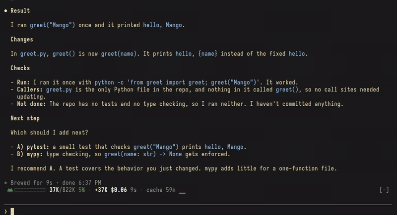
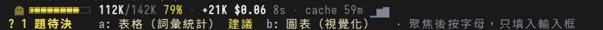
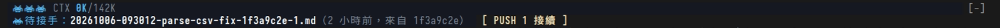

# mango-mods

**給長時間 session 用的 Claude Code mod：一眼看出回覆停在哪，context 滿之前先交接。**

Claude Code 的 session 跑得越久，有兩件事越麻煩。回覆越寫越長，你要的東西（成功沒有、Claude 要你做什麼）埋在中間。context 也會滿：自動壓縮把對話擠成一段你看不到的摘要，你在意的細節可能就此消失。這兩個 mod 各處理一件：

| plugin | 用途 |
|---|---|
| [sitrep](sitrep/README.zh-TW.md) | 每則長回覆下方一個結論框：狀態、一句結論、你要做的事、可收合的段落（變更、驗證）、等你回答的題目；提示框上方一列可用鍵盤選答。框裡每個字都是回覆原句：小模型只挑行號 |
| [ctx-relay](ctx-relay/README.zh-TW.md) | band 顯示 context 大小、每輪花費和 prompt cache 倒數；context 滿之前寫一份你看得懂的交接檔、`/clear`、在新對話接續。不需要其他 skill 或 hook |
| [xv-band](xv-band/README.zh-TW.md) | Early access：提示框上方一列顯示 xvendor 跨廠審查 job 的即時狀態。要搭配 xvendor 才有用，xvendor 尚未公開 |

mod 是用 JS/TS function hooks 寫成的 Claude Code plugin：可以在提示框上方畫一行 band、在對話旁開 pane、對 session 事件做反應。這個 repo 是 plugin marketplace，結構和官方 [claude-code-playground/claude-code/mods](https://github.com/anthropics/claude-code-playground/tree/main/claude-code/mods) 一樣，每個 plugin 一個目錄。

> English: [README.md](README.md)。各 plugin 的中文說明在該目錄的 `README.zh-TW.md`。sitrep 的標籤預設英文（`language` 設定可換成繁體中文）；ctx-relay 的 band 和指令是英文。模型寫的內容跟著對話語言走。

## sitrep





*Claude 改檔、跑一次，然後問一題。結論框把變更、驗證各收成一行；`Ctrl+X Tab` 聚焦提示框上方那列，按 `a` 把答案填進提示框（不會送出）。*

長回覆結束後，`haiku` 只挑行號，mod 用回覆原句組成結論框，框裡不會出現回覆沒說的話。細節見 [sitrep/README.zh-TW.md](sitrep/README.zh-TW.md)。

## ctx-relay





進度條往交接線填滿（預設是自動壓縮點的 85%），越接近越變色（這裡一輪從 66% 綠漲到 76% 黃）。每輪結束時，這輪新增的格子亮一下。右邊是本輪增量、花費、prompt cache 還熱多久，以及最近幾輪的長條。

為什麼交接，而不讓自動壓縮處理：交接檔是放在 repo `.git` 資料夾裡的一般 Markdown 檔（Goal、Files、Verified、Next），你看得到也改得了，新對話也被要求先對照 git 再動手。



新對話開場時，如果有還沒人接手的交接檔，band 下面多一行；按 `1` 送出接續指令。細節見 [ctx-relay/README.zh-TW.md](ctx-relay/README.zh-TW.md)。

截圖都來自一次性測試 repo 裡的真實 Claude Code session，做法見 [docs/demo/](docs/demo/)。

## 需求

- Claude Code 2.1.289 以上，測到 2.1.296。mods API 還在 early access，Claude Code 改版後可能要跟著改。
- 不用另外開旗標或改設定：mod 裝好就預設啟用。
- PATH 上要有 `bash` 和 `git`。
- ctx-relay 的圖示需要 Nerd Font（3.0 以上），例如把 Symbols Nerd Font 設成備用字型；沒有的話會顯示成方塊。

## 安裝

```bash
claude plugin marketplace add mangow314/mango-mods
claude plugin install sitrep@mango-mods
claude plugin install ctx-relay@mango-mods
```

設定（sitrep 的 `language`、ctx-relay 的交接線與交接檔格式）在 `/config`。

## 費用與隱私

- sitrep 每則長回覆（800 字以上或有 2 個以上標題）送給 `haiku` 一次，只拿行號。
- ctx-relay 寫交接檔時發一次 fork 請求，大約等於一輪沒命中快取的花費。
- 兩種請求都走你自己的 Claude Code 帳號，跟一般對話一樣；mod 不會把資料送到別的地方。ctx-relay 會跑 `git` 指令，交接檔寫在 `.git/harness/`（在 `.git` 裡，不會被 commit）；不在 git 裡時寫在 `~/.claude/harness/`。
- ctx-relay 倒數 60 秒後會自己 `/clear`（按 `1` 取消），再在新對話送出接續訊息。

## 移除

```bash
claude plugin uninstall sitrep@mango-mods
claude plugin uninstall ctx-relay@mango-mods
claude plugin marketplace remove mango-mods
```

`claude plugin disable <plugin>@mango-mods` 只停用、不移除。交接檔留在 `.git/harness/handoff/`，刪掉那個資料夾即可清乾淨。

## 回饋

這是我每天在用的個人專案。bug、「這裡看不懂」、點子都歡迎開 [GitHub Issues](https://github.com/mangow314/mango-mods/issues)。最有幫助的是：你的 Claude Code 版本、截圖，以及你原本預期看到什麼。

## 開發與發布

- 開發時直接載入目錄，不要用已安裝的副本（已安裝的 plugin 按版本快取）：`git clone https://github.com/mangow314/mango-mods`，再 `claude --plugin-dir ./mango-mods/<plugin>`。
- 檢查：在 plugin 目錄裡跑 `claude plugin validate .`、`claude plugin test .`、`npx -p typescript@5 tsc -p .`。tsc 需要先載入一次 mod，引擎才會產生 `.claude-plugin/types/`，這個目錄不進版控。
- 發布：先調高該 plugin `plugin.json` 的 `version`，然後 commit、push，再跑 `claude plugin marketplace update mango-mods`，最後更新已安裝的版本。
- 安裝任何 mod 前，先看 `claude plugin validate --json` 列出的 hooks 和 calls 清單。
- 已下架的 plugin（repo-ledger、your-turn、away-receipt）留在 git tag `archive/mods-before-cleanup`。

## 授權

[MIT](LICENSE)，涵蓋這個 repo 裡所有 plugin。
